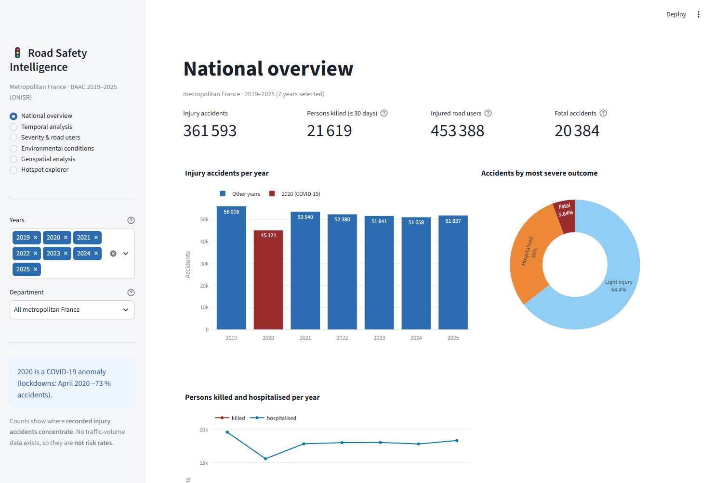
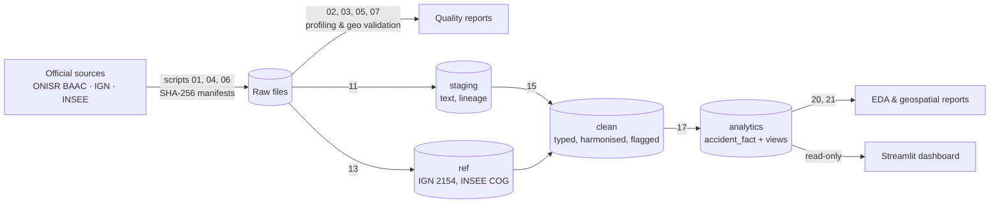
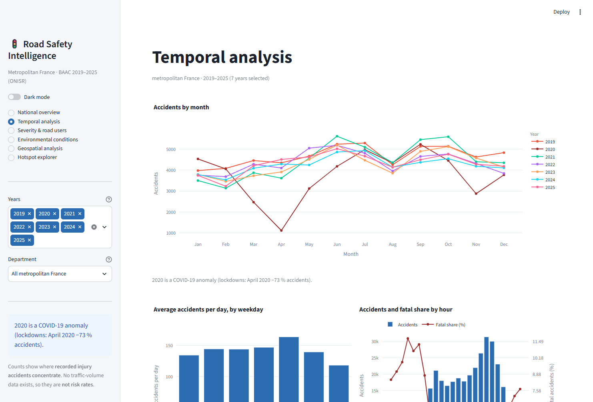
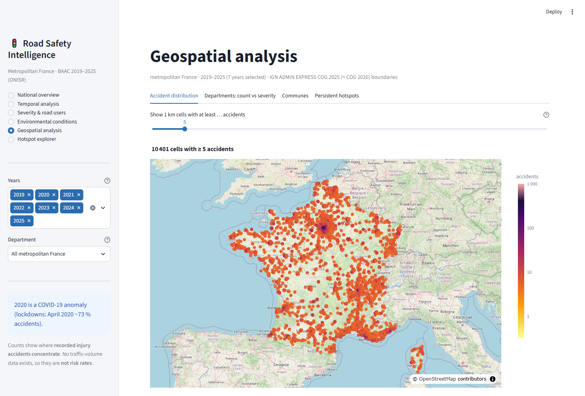
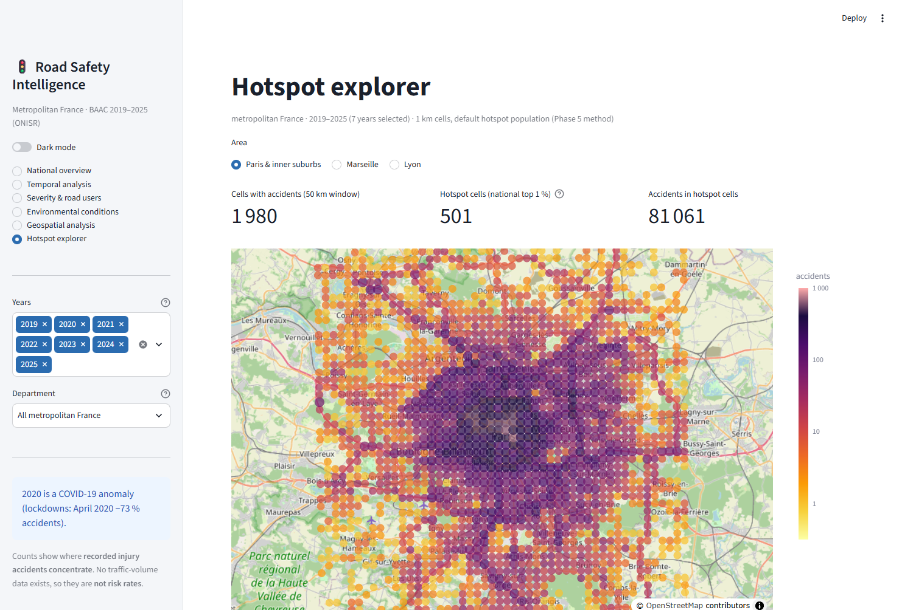

# Road Safety Intelligence — France

**Data engineering, statistical analysis and geospatial data science on French road-injury accidents (2019–2025).**


[](LICENSE)

An end-to-end, reproducible pipeline built on the official French road-accident database (BAAC, ONISR):
raw-data acquisition with checksums → data-quality profiling → geographic validation against official IGN
boundaries → PostgreSQL/PostGIS warehouse (staging → clean → analytics) → statistical and geospatial
analysis → interactive Streamlit dashboard.



---

## Key results (metropolitan France, 2019–2025)

| | |
|---|---|
| Injury accidents | **361 593** |
| Persons killed (≤ 30 days) | **21 619** |
| Injured road users (hospitalised + light) | **453 388** |
| Accidents with exact or ≤ 500 m validated coordinates | **99.8 %** (360 934) |

- **2020 COVID-19 anomaly:** −14.5 % accidents and −20.1 % deaths versus the other years (April 2020: −73 %).
- **Night accidents are about twice as often fatal** (10.0 % between 00:00 and 05:59 vs 5.2 % during the day).
- **Rural vs urban:** accidents outside built-up areas are 3.5× as often fatal (10.3 % vs 3.0 %; Cramér's V = 0.26).
- **Vulnerable users:** pedestrians, two/three-wheelers and cyclists have the highest killed-or-hospitalised shares (27–34 %); users aged 75+ the highest fatality share (8.4 %).
- **Hotspots:** 1 % of 1 km cells hold 32.5 % of accidents but only 6.2 % of fatal accidents — accidents concentrate in cities, fatal accidents are dispersed on rural networks.

All results describe **police-recorded injury accidents** and their **concentration**, not risk: no traffic-volume
(exposure) data exists. See [Limitations](#limitations).

---

## Features

- **Reproducible acquisition** — official files downloaded by script, checked against the publisher's size/MD5,
  SHA-256 recorded in committed manifests; raw files are never modified.
- **Data-quality profiling** of the 28 BAAC files (4 tables per year: characteristics, locations, vehicles, road users):
  schema drift, missing-value tokens, key uniqueness, joins, coordinate precision.
- **Geographic validation** — point-in-polygon checks against the IGN boundaries of each accident year; obsolete
  commune codes harmonised with the INSEE COG history; anomalies flagged, coordinates never silently corrected.
- **Layered PostgreSQL/PostGIS warehouse** (staging → clean → analytics) with lineage, primary/foreign keys and no
  double counting across one-to-many tables.
- **Independent validation at every stage** — 509 automated checks, results stored in `meta.dq_check`.
- **Descriptive statistical analysis** — temporal patterns, severity, environment and road users (χ², Cramér's V,
  95 % confidence intervals); no machine learning or predictive modelling.
- **Geospatial analysis** — department and commune distributions, 1 km grid hotspots and their persistence across years.
- **Interactive Streamlit dashboard** — six sections, year and department filters, read-only database access,
  Light / Dark mode.

## Tech stack

| Area | Tools |
|---|---|
| Database | PostgreSQL 18 + PostGIS 3.6 (Docker Compose, image pinned by digest) |
| Language | Python 3.13 |
| Data processing | pandas 3.1, NumPy 2.5 |
| Geospatial | GeoPandas 1.2, Shapely 2.2, pyproj 3.8, pyogrio 0.13 |
| Database access | psycopg 3.3 |
| Statistics | SciPy 1.18 |
| Static figures (reports) | Matplotlib 3.11, seaborn 0.13 |
| Dashboard | Streamlit 1.67, Plotly 7.1 (MapLibre maps, OpenStreetMap tiles) |

Exact versions: [`requirements.txt`](requirements.txt).

---

## Architecture



| Layer | Content | Key rules |
|---|---|---|
| **Raw** | 28 BAAC CSVs, 7 IGN ADMIN EXPRESS COG editions, INSEE COG 2026 | immutable; SHA-256 in `_manifest.csv` |
| **staging** | source values as text, untouched | lineage (file, row, load run); no row can be dropped |
| **ref** | IGN commune/department polygons (EPSG:2154), INSEE history, commune harmonisation, geo-validation results | one IGN edition per accident year |
| **clean** | `accident`, `accident_location`, `vehicle`, `road_user`, `dq_issue` | PK/FK enforced; vehicle↔user on `(id_vehicule, num_acc)`; anomalies flagged, never deleted |
| **analytics** | `accident_fact` (1 row per metropolitan accident) + summary and fact views | one-to-many tables aggregated before any join (no double counting) |

Every stage has an independent validation script; results are stored in `meta.dq_check`.

---

## Dashboard

Six sections: national overview · temporal analysis · severity & road users · environmental conditions ·
geospatial analysis · hotspot explorer. Filters: years and department. Read-only database access.

**Light / Dark mode:** a *Dark mode* toggle in the sidebar switches the display theme (Light by default). The choice
applies to the current browser session only. Only backgrounds, text, inputs, tables and chart backgrounds/axes change;
data, chart colours, colour scales and the OpenStreetMap basemap stay the same in both modes (`app/theme.py`).

| Temporal analysis | Geospatial analysis |
|---|---|
|  |  |

| Hotspot explorer (Paris, 1 km cells) |
|---|
|  |

---

## Repository structure

```
app/                Streamlit dashboard (streamlit_app.py, data.py, labels.py, theme.py = Light/Dark mode)
.streamlit/         config.toml: default (light) theme, headless server, usage statistics off
db/init/            database initialisation (PostGIS + schemas)
db/sql/             DDL for meta, staging, ref, clean and analytics layers
scripts/            numbered pipeline and validation scripts (see execution order)
data/raw/           raw data (NOT in git) + _manifest.csv files with URLs and SHA-256
reports/phase1..6/  data-quality, design, pipeline, EDA, geospatial and dashboard reports
reports/geography/  geographic validation and commune-code mapping (+ tables used by the pipeline)
docs/images/        dashboard screenshots
docker-compose.yml  PostgreSQL 18 + PostGIS 3.6 (image pinned by digest)
```

---

## Setup

**Requirements:** Docker Desktop · Python 3.13 · ~10 GB free disk space · internet access (data download, map tiles).
Developed and tested on Windows 11; the scripts are platform-independent (7z extraction needs a libarchive
`tar`: built in on Windows 10/11 and macOS, `libarchive-tools` on Linux).

```powershell
# 1. Python environment
python -m venv .venv
.venv\Scripts\activate            # macOS/Linux: source .venv/bin/activate
pip install -r requirements.txt

# 2. Database credentials (never committed)
copy .env.example .env            # macOS/Linux: cp .env.example .env
#    then set a strong RSI_DB_PASSWORD in .env

# 3. PostgreSQL + PostGIS (host port 5433)
docker compose up -d
python scripts/10_verify_database.py
```

## Pipeline execution order

Run from the project root with the virtual environment active.

| Step | Command | What it does |
|---|---|---|
| Acquire | `python scripts/01_acquire_baac.py` | BAAC 2019–2025 (28 CSVs, ~223 MB), size checked against the API, SHA-256 recorded |
| | `python scripts/04_acquire_geography.py` | IGN ADMIN EXPRESS COG 2019–2025 (~1.5 GB), size + MD5 checked against IGN, SHA-256 recorded, layer extraction |
| | `python scripts/06_acquire_insee_cog.py` | INSEE COG 2026 commune history |
| Profile *(optional, regenerates reports)* | `python scripts/02_profile_baac.py` · `03_deep_checks.py` | data-quality tables (Phase 1) |
| Geo validation *(optional, regenerates committed tables)* | `python scripts/05_validate_geography.py` · `07_map_obsolete_communes.py` | point-in-polygon validation, obsolete commune codes |
| Staging | `python scripts/11_load_staging_baac.py` → `12_validate_staging.py` → `staging_fingerprint.py --write` | untouched text copy + 204 checks + fingerprint baseline |
| Reference | `python scripts/13_load_reference_data.py` → `14_validate_reference_data.py` | IGN/INSEE/geo-validation reference data (≈ 15 min) |
| Clean | `python scripts/15_build_clean.py` → `16_validate_clean.py` | typed, harmonised tables (≈ 10 min) |
| Analytics | `python scripts/17_build_analytics.py` → `18_validate_analytics.py` | `accident_fact` and views |
| Analysis | `python scripts/20_phase4_eda.py` · `21_phase5_geospatial.py` | figures and tables in `reports/phase4`, `reports/phase5` |

**Upstream revisions and checksums:** resources are resolved at run time (BAAC through the data.gouv.fr API) and each
download is checked against the publisher's metadata — file size for BAAC, size + MD5 for IGN; INSEE files are fetched from fixed URLs — then hashed
(SHA-256) and written to `_manifest.csv`, which the scripts **regenerate**. The committed manifests record the exact
files used for the reported results. If ONISR publishes a revised BAAC file, or IGN/INSEE update a resource, the
regenerated SHA-256 values will no longer match the committed ones (compare the manifests, e.g. with `git diff`)
and results may differ slightly. If a resource is renamed, removed or its download URL changes, the scripts stop
with an `ABORT` message (or a download error) and the resource selection or URL must be updated.

`reports/geography/tables/` (committed) contains the geographic-validation outputs required by step 13, so
steps 05/07 do not need to be re-run.

## Launch the dashboard

```powershell
streamlit run app/streamlit_app.py      # then open http://localhost:8501
```

## Validation

| Command | Checks |
|---|---|
| `python scripts/12_validate_staging.py` | 204 — row counts, byte-level value fingerprints, columns, lineage |
| `python scripts/14_validate_reference_data.py` | 158 — counts, geometry validity, SRID, INSEE coverage, integrity |
| `python scripts/16_validate_clean.py` | 103 — PK/FK, orphans, totals, commune harmonisation, no fan-out |
| `python scripts/18_validate_analytics.py` | 19 — one row per accident, totals reconcile |
| `python scripts/22_validate_dashboard.py` | 25 — all sections render, totals, filters, maps, read-only |

---

## Data sources & licences

| Source | Producer | Licence | Attribution |
|---|---|---|---|
| [BAAC — Bases de données annuelles des accidents corporels de la circulation routière](https://www.data.gouv.fr/datasets/bases-de-donnees-annuelles-des-accidents-corporels-de-la-circulation-routiere-annees-de-2005-a-2025) | Ministère de l'Intérieur / ONISR | Licence Ouverte / Open Licence | "Source : ONISR, BAAC" |
| [ADMIN EXPRESS COG](https://geoservices.ign.fr/adminexpress) 2019–2025 | IGN | Licence Ouverte 2.0 | "Source : IGN, ADMIN EXPRESS COG" |
| [Code officiel géographique 2026](https://www.insee.fr/fr/information/8740222) | INSEE | Licence Ouverte | "Source : INSEE, COG" |
| Map tiles (dashboard) | © OpenStreetMap contributors | ODbL | shown on every map |

Raw data are **not** redistributed in this repository; the acquisition scripts download them from the official
sources and record their checksums in the committed manifests.

**Licence scope:** the [MIT licence](LICENSE) covers the original source code, SQL and documentation of this
project only. External datasets (ONISR BAAC, IGN ADMIN EXPRESS COG, INSEE COG) and map tiles (OpenStreetMap) are
**not** covered; they remain under their own licences and attribution requirements listed above.

## Limitations

- **Concentration, not risk:** no traffic-volume data; counts and hotspots show where recorded injury accidents occur.
- **"Hospitalised"** (> 24 h) is not an officially certified indicator since 2019 and is not comparable with years ≤ 2017.
- **Recording changes:** fugitive road users recorded from 2021; multi-segment `Lieux` records from 2023; road category 7 unstable; 2020 COVID anomaly.
- **Geography:** 659 accidents (0.18 %) excluded from point analysis (606 wrong-commune points kept for sensitivity); 11 proposed coordinate corrections are documented but not applied; 2019–2020 coordinates are less precise.
- **Descriptive statistics only:** bivariate associations (χ², Cramér's V) — no causal claims, no predictive modelling.

Full methodology and evidence: [`reports/`](reports) (Phase 1 data quality → Phase 6 dashboard).
