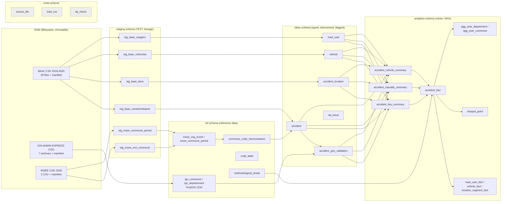
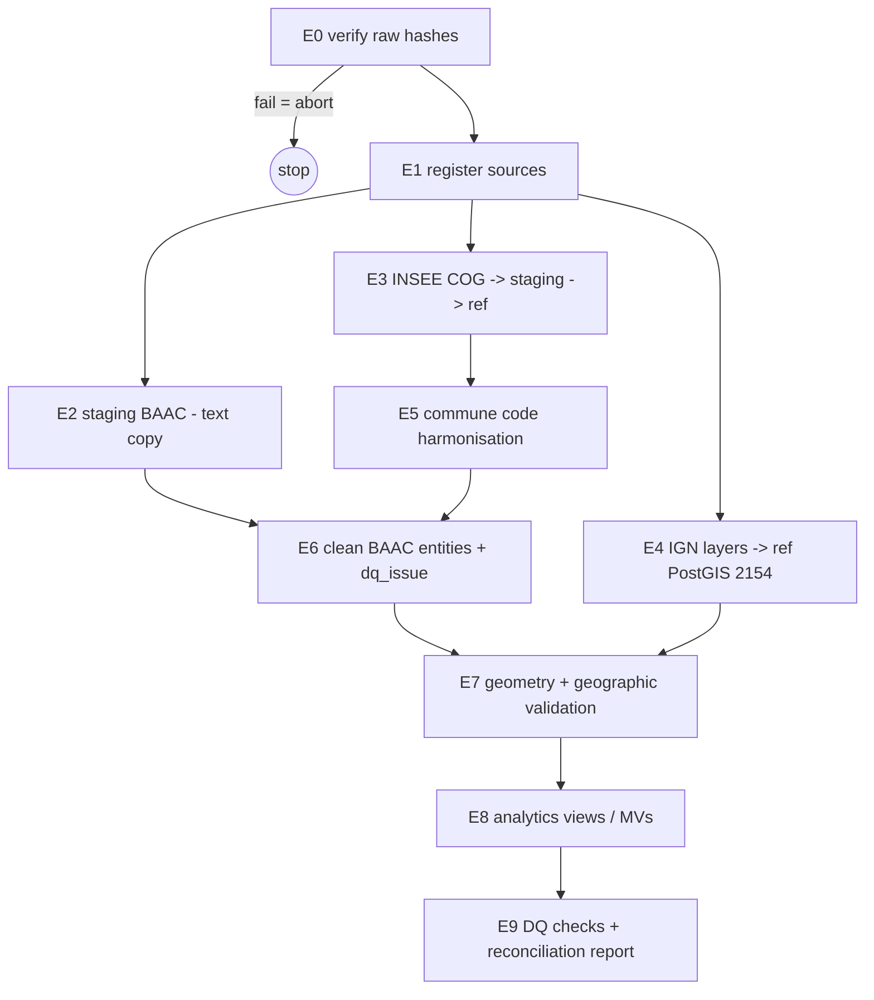

# Phase 2 — Architecture Design
**Road Safety Intelligence — France** · Data Engineering, Statistical Analysis & Geospatial Data Science
Status: **DESIGN ONLY** — nothing in this document has been implemented. 2026-11-11.

Companion documents: [`database_schema.md`](database_schema.md) · [`data_dictionary.md`](data_dictionary.md) · [`geographic_data_model.md`](geographic_data_model.md) · [`phase2_design_decisions.md`](phase2_design_decisions.md)

---

## 0. Pre-design audit (performed on actual files)

The audit re-read every BAAC file 2019–2025, the INSEE COG files, the IGN layers and all Phase 1 tables with a read-only script (scratchpad, not part of the project). Verified facts used in this design:

| Item | Verified result |
|---|---|
| Project content | `data/raw/{baac,geography}` (immutable, manifests with SHA-256), `scripts/01–07`, `reports/phase1`, `reports/geography`; **no** database, no ETL code |
| Volumes 2019–2025 | 382 721 accidents · 430 628 Lieux rows · 653 712 vehicles · 871 534 road users |
| Metropolitan scope | 361 593 accidents (dep 01–95, 2A, 2B after zero-padding); 21 128 overseas |
| Raw headers | Caract.: identical except **2022 `Accident_Id`**; Lieux: identical 7 years; Véhicules: identical except **2025 `"id_vehicule\n"`**; Usagers: **no `id_usager` 2019–2020**, present 2021–2025 (column order shifts by one) |
| `Num_Acc` | 12 digits, **unique across all 7 years**, present in all 4 tables, 0 orphans in any direction |
| `id_vehicule` | numeric, ≤ 9 digits after removing space separators, **unique across all years** |
| `id_usager` | numeric, ≤ 9 digits, **unique across 2021–2025** (633 262 rows), absent 2019–2020 (238 272 rows) |
| Vehicle ↔ user | every `usagers.id_vehicule` exists in `vehicules`; the user's `Num_Acc` and `num_veh` always equal the vehicle's |
| `(Num_Acc, num_veh)` | **not unique** (2019: 106 rows/53 accidents; 2022: 4; 2024: 2); 4 odd `num_veh` values (`[01`, `\01`, `]01`, `_01`) |
| Lieux | 1 row/accident 2019–2022; **2–5 rows for ~29 % of accidents 2023–2025**, only at intersections; no row identifier, no vehicle link, `catr` constant within an accident |
| Commune codes | 25 394 distinct metro codes: 25 042 active COM 2026, **45 municipal-arrondissement codes (46 883 accidents)**, **307 codes not valid in 2026 (1 079 accidents)** — 306 resolve to exactly one COG 2026 commune (chains of 1–2 steps), 1 = `N/C` |
| COG 2026 vs IGN 2025 | identical metropolitan commune code sets (34 746 = 34 746); no COM→COM code change after 2025-01-01 |
| Environment | Python venv (pandas 3.1.1, geopandas 1.2.0, shapely, pyproj, pyogrio); **PostgreSQL 18.6 installed and running; PostGIS extension NOT installed**; Docker 29.9.2 available |
| Not verifiable / flagged | (1) The *Phase 1B critical investigation* exists only as a chat deliverable — **no report file**; its findings are reproduced here from Phase 1 tables. (2) Why some single-vehicle accidents have several Lieux rows (undocumented by ONISR). (3) How the single Lieux row was chosen at intersections in 2019–2022. |

---

## 1. Architectural principles

1. **Immutability of raw data** — raw files are never modified; every downstream row carries lineage to `(source_file_id, source_row_number)`.
2. **Declared grain for every table** — accident, road segment (Lieux), vehicle, road user; joins are only allowed *child → parent* (many-to-one) in analytical views, never sibling → sibling.
3. **Preserve, then derive** — original values are kept (staging, `*_original` columns); harmonised values live in separate columns; nothing is silently overwritten.
4. **Flags over deletion** — anomalies are flagged and logged (`clean.dq_issue`), never removed; exclusion happens in the analytical layer through explicit eligibility columns.
5. **Methodological limits are data** — breaks (COVID 2020, fugitive users 2021, Lieux 2023, non-certified hospitalised indicator…) are stored in a reference table and exposed as columns in analytical views.
6. **Full, deterministic rebuild** — ~2.3 M rows in total: a full idempotent rebuild is simpler and safer than incremental loads. A new year = new raw files + rebuild.
7. **Minimal technology** — Python (pandas/GeoPandas) + PostgreSQL/PostGIS + SQL. No orchestrator, no message queue, no cloud service.

---

## 2. Layered architecture

### 2.1 RAW layer (filesystem — already exists)

| Aspect | Specification |
|---|---|
| Purpose | Immutable evidence of what was published by ONISR, IGN and INSEE |
| Content | `data/raw/baac/<year>/*.csv`, `data/raw/baac/docs/*.pdf`, `data/raw/geography/admin_express_cog/archives/*.7z`, `data/raw/geography/insee_cog/2026/*.csv`; manifests `_manifest.csv` (URL, size, SHA-256, licence, retrieval time) |
| Responsibilities | Storage only; files read-only |
| Derived, re-creatable | `data/raw/geography/admin_express_cog/extracted/<year>/` (layers extracted from archives) |
| DQ controls | **E0 gate**: SHA-256 of every file must equal its manifest before any load; abort otherwise |

### 2.2 META schema

| Table | Purpose |
|---|---|
| `meta.source_file` | One row per raw file: source system, entity, year/edition, path, URL, bytes, SHA-256, licence, producer, raw header (exact), manifest row |
| `meta.load_run` | One row per pipeline execution: start/end, status, script version (file hashes — the project is not a git repository), parameters |
| `meta.dq_check` | Result of every automated check: run, layer, check code, entity, year, expected, observed, status (`pass`/`warn`/`fail`) |

### 2.3 STAGING layer

| Aspect | Specification |
|---|---|
| Purpose | Faithful, queryable copy of the source files with lineage; the only transformation is **column-name canonicalisation** |
| Tables | `staging.stg_baac_caracteristiques`, `stg_baac_lieux`, `stg_baac_vehicules`, `stg_baac_usagers` (all years in one table per entity), `stg_insee_mvt_commune`, `stg_insee_commune_period` |
| Columns | all source columns as `TEXT`, **values untouched** (whitespace, `" -1"`, `N/A`, `(1)`, `#VALEURMULTI`, U+00A0, decimal commas all preserved) + `source_file_id`, `source_year`, `source_row_number` (1-based data row), `load_run_id` |
| Transformations | header canonicalisation only: strip whitespace/newlines (`"id_vehicule\n"` → `id_vehicule`), `Accident_Id` → `num_acc`, lower-case; `id_usager` NULL for 2019–2020 (column absent, recorded in `meta.source_file.raw_header`) |
| Dependencies | RAW, `meta.source_file` |
| DQ controls | row count per file = Phase 1 count (e.g. 2023 Lieux = 70 860); 0 rows with wrong field count; header mapping fully recognised (unknown column → fail); file hash re-checked |

IGN geometries are not staged in PostgreSQL as text; they are loaded directly into `ref` by GeoPandas (lineage via `source_file_id` + `edition_year`).

### 2.4 REF layer (reference data)

| Table | Purpose |
|---|---|
| `ref.ign_commune`, `ref.ign_departement` | ADMIN EXPRESS COG polygons, one set per edition 2019–2025, EPSG:2154, `ST_MakeValid` applied and recorded |
| `ref.insee_cog_event`, `ref.insee_commune_period` | typed copies of INSEE `v_mvt_commune_2026` and `v_commune_depuis_1943` |
| `ref.commune_code_harmonisation` | one row per BAAC commune code: status in 2026, ARM parent, `com_cog_2026`, chain, transformation class |
| `ref.code_label` | BAAC codebook (variable, code, label, validity years, source document) from the ONISR 2026 description |
| `ref.methodological_break` | registry of comparability breaks and their treatment |

### 2.5 CLEAN layer

| Aspect | Specification |
|---|---|
| Purpose | One typed, harmonised, constraint-checked table per grain, with quality flags and full lineage |
| Tables | `clean.accident` (1/accident), `clean.accident_location` (1/Lieux row), `clean.vehicle` (1/vehicle), `clean.road_user` (1/user), `clean.accident_geo_validation` (1/accident), `clean.dq_issue` (1/issue) |
| Transformations | trim; remove thousands separators (space, U+00A0); decimal comma/point → numeric; missing tokens → NULL (rules in data dictionary); `dep` zero-padding; type conversion; derived fields (date, time, hour, age, severity rank, fugitive-like, eligibility); commune harmonisation; geometry creation; geographic validation |
| Not done here | No row deletion, no imputation, no coordinate overwrite, no aggregation |
| Dependencies | staging, ref |
| DQ controls | PK uniqueness; FK integrity (expected 0 orphans); row counts staging = clean per entity/year; codes ∈ `ref.code_label` or NULL (+ `dq_issue`); counts of known anomalies equal Phase 1 measurements (e.g. `nbv` `#VALEURMULTI` 54/50/24); geo-validation category counts reconcile with Phase 1C (361 593 metro accidents, 354 708 valid…) |

### 2.6 ANALYTICS layer

| Aspect | Specification |
|---|---|
| Purpose | Grain-safe, documented inputs for statistics, spatial analysis and the future Streamlit/Plotly app |
| Objects | 1:1 accident summaries (`accident_lieu_summary`, `accident_casualty_summary`, `accident_vehicle_summary`), `accident_fact`, `road_user_fact`, `vehicle_fact`, `location_segment_fact`, `hotspot_point`, `agg_year_department`, `agg_year_commune` |
| Responsibilities | Expose only many-to-one joins; carry scope, comparability and geographic-eligibility columns; never re-derive cleaning logic |
| Dependencies | clean, ref |
| DQ controls | grain checks (`count(accident_fact) = count(clean.accident)`; summaries have exactly one row per accident); additive reconciliation (Σ `n_killed` in `accident_fact` = count of killed users in `clean.road_user`; Σ `n_vehicles` = count of `clean.vehicle`) |

---

## 3. Component responsibilities (future Python modules — not implemented)

| Component | Responsibility | Reads | Writes |
|---|---|---|---|
| `verify_raw` | E0 hash gate against the three manifests | raw files, manifests | `meta.dq_check` |
| `register_sources` | populate `meta.source_file` (incl. exact raw headers) | manifests, file headers | `meta.source_file` |
| `load_staging_baac` | read CSVs as text (`;`, UTF-8, `dtype=str`, no NA conversion), canonicalise headers, bulk `COPY` | BAAC CSV | `staging.stg_baac_*` |
| `load_ref_insee` | load + type INSEE COG files | INSEE CSV | `staging.stg_insee_*`, `ref.insee_*` |
| `load_ref_ign` | read layers per edition, reproject to 2154, `make_valid`, write PostGIS | extracted IGN layers | `ref.ign_commune`, `ref.ign_departement` |
| `build_commune_harmonisation` | resolve every BAAC commune code to COG 2026 (chain over INSEE events) | `ref.insee_*`, staging codes | `ref.commune_code_harmonisation` |
| `build_clean` | typed conversion, NULL rules, flags, dq_issue (SQL `INSERT … SELECT` from staging) | staging, ref | `clean.*` |
| `build_geo_validation` | PostGIS point-in-polygon per year edition; categories; proposed corrections; reconciliation with Phase 1C | `clean.accident`, `ref.ign_*`, `ref.commune_code_harmonisation` | `clean.accident_geo_validation` |
| `build_analytics` | create/refresh views and materialised views | clean, ref | `analytics.*` |
| `dq_report` | run all checks, write markdown summary | meta, all layers | `meta.dq_check`, `reports/phase3/…` |

Execution: a single Python entry point running the steps in order inside one `load_run` (no orchestrator).

---

## 4. ETL flow (raw → PostgreSQL/PostGIS)

| Step | Key rules | Gate (must pass) |
|---|---|---|
| E0 | SHA-256 = manifest for 28 BAAC + 2 PDF + 7 IGN + 2 INSEE files | all match |
| E2 | `COPY` text; one staging table per entity | row counts = Phase 1; 0 malformed rows |
| E3 | 13 734 events, 42 333 periods | counts match file |
| E4 | 7 editions; metro filter by department code; `ST_MakeValid` (4 invalid 2019 geometries) | 34 886 / 34 839 / 34 836 / 34 826 / 34 816 / 34 806 / 34 746 metro communes; 96 departments each |
| E5 | identity / ARM→parent / chain resolution; ambiguity → NULL | 306 resolved + `N/C` unresolved for metro; 0 ambiguous |
| E6 | typing & NULL rules (data dictionary); every rule violation logged | PK/FK pass; staging = clean counts |
| E7 | edition of accident year; categories in fixed order; corrections proposed only | category counts reconcile with Phase 1C |
| E8 | views reference only clean/ref | grain + additivity checks |
| E9 | all checks persisted; report generated | no `fail` |

Load mechanics (to confirm in Phase 3): pandas/GeoPandas for parsing; `psycopg` `COPY` for staging; SQL for clean/analytics; `GeoDataFrame.to_postgis` for IGN (needs SQLAlchemy + GeoAlchemy2) — see decisions D-04 (PostGIS) and D-05 (libraries).

---

## 5. How the architecture prevents fan-out and double counting

| Risk | Prevention |
|---|---|
| Lieux 1:N (2023+) multiplies accidents / casualties | `clean.accident_location` is never joined directly to users or vehicles in analytics; it is collapsed to `analytics.accident_lieu_summary` (PK `num_acc`, exactly one row) before any join. Segment-level analysis uses `location_segment_fact`, documented as "accident–road involvements", never as accidents |
| Accident counts from child tables | `accident_fact` has grain = accident (PK); accident KPIs are `COUNT(*)` on it. Casualty KPIs come from `road_user_fact` or pre-aggregated `accident_casualty_summary` |
| Vehicle ↔ user mis-linking | FK `road_user(id_vehicule, num_acc) → vehicle(id_vehicule, num_acc)`; `num_veh` is descriptive only, never a join key |
| Users without vehicles / vehicles without users | users always have a vehicle (FK NOT NULL, verified); vehicles without users (fugitive drivers 2019–2020) are kept and flagged, so vehicle counts stay correct |
| Sibling joins (vehicle × user × lieux) | analytical views join only towards parents: user → vehicle → accident; lieux → accident; summaries → accident |
| Silent duplication in MVs | DQ checks after each refresh: row count of each 1:1 summary = accidents; Σ casualties in `accident_fact` = users by severity |

---

## 6. Analytical requirements coverage

| Requirement | Supported by | Limitation made visible by |
|---|---|---|
| Annual accident trends 2019–2025 | `accident_fact` (year, in_core_scope) | `is_covid_year`, `methodological_break` |
| Fatal accident trends | `accident_fact.accident_severity = 'fatal'` / `n_killed > 0` | — |
| Killed / hospitalised / light counts | `accident_casualty_summary`, `road_user_fact.grav` | `hospitalised_not_certified` note column |
| Severity distribution | `accident_fact.accident_severity`, `road_user_fact.severity_rank` | `grav` unknown (2021–2023) counted separately |
| Temporal patterns | `acc_date`, `acc_time`, `hour`, `weekday`, `month`, `season` | — |
| Road / environmental conditions | accident (`lum`, `atm`, `agg`, `intersection`, `col`) + `accident_lieu_summary` (`catr`, `surf`, `vma_*`, conflicts) | `lieux_regime` (2019–22 single row vs 2023+ multi) |
| Vehicle categories | `vehicle_fact.catv` (+ groups) | EDP/VAE category adoption note |
| Road-user characteristics | `road_user_fact` (catu, sexe, age, secu1–3, trajet) | `is_fugitive_like`, `an_nais_placeholder` |
| Department comparisons | `agg_year_department` (dep_code) | scope = metro |
| Commune comparisons | `agg_year_commune` on `com_cog_2026` | mapping class/confidence; arrondissement level only via `com_arm` |
| Hotspots / density | `hotspot_point` (eligible geometries, 2154, GiST) | eligibility categories; "concentration ≠ risk" note |
| Factors associated with severity | `road_user_fact` / `accident_fact` with all covariates at correct grain | descriptive/statistical only — no models (project rule) |

No traffic-volume denominator exists in any source: all rates are per accident/per casualty, never per vehicle-km; this is stated in `ref.methodological_break` (`NO_EXPOSURE_DENOMINATOR`) and exposed in every aggregate view.
