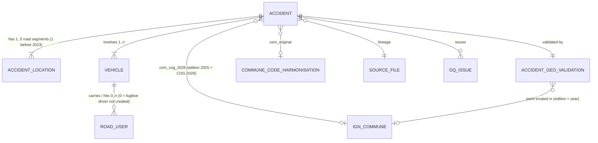

# Phase 2 — Database Schema (proposed)
**Road Safety Intelligence — France** · PostgreSQL 18 + PostGIS · Status: **DESIGN ONLY** (no object created)

Conventions: schemas `meta`, `staging`, `ref`, `clean`, `analytics`; snake_case; `smallint` for coded categorical variables (with `CHECK` against the documented codebook — `NULL` = not recorded); geometry SRID **2154** (Lambert-93). "PK", "FK", "UQ", "NN" = primary key, foreign key, unique, NOT NULL.

Volumes (2019–2025, verified): accidents 382 721 · Lieux rows 430 628 · vehicles 653 712 · road users 871 534.

---

## 1. Entity-relationship overview

Relationship cardinalities verified on the data: every vehicle and user belongs to an existing accident; every user's `id_vehicule` exists and belongs to the same accident; every accident has ≥ 1 vehicle, ≥ 1 user, ≥ 1 Lieux row.

---

## 2. META schema

### `meta.source_file`
| Column | Type | Null | Notes |
|---|---|---|---|
| source_file_id | integer GENERATED ALWAYS AS IDENTITY | NN | **PK** |
| source_system | text | NN | CHECK in ('BAAC','IGN','INSEE','ONISR_DOC') |
| entity | text | NN | e.g. `caracteristiques`, `lieux`, `ign_commune`, `insee_mvt_commune` |
| reference_year | smallint | NULL | BAAC year / IGN edition year / COG vintage |
| file_path | text | NN | **UQ**, relative to project root |
| source_url | text | NN | |
| bytes | bigint | NN | |
| sha256 | char(64) | NN | |
| licence | text | NN | |
| producer | text | NN | |
| published_or_edition_date | date | NULL | |
| retrieved_at | timestamptz | NN | from manifest |
| raw_header | text | NULL | exact header line (e.g. `"id_vehicule\n"`) |

### `meta.load_run`
| Column | Type | Null | Notes |
|---|---|---|---|
| load_run_id | integer IDENTITY | NN | **PK** |
| started_at / finished_at | timestamptz | NN / NULL | |
| status | text | NN | CHECK in ('running','succeeded','failed') |
| code_fingerprint | text | NN | SHA-256 of pipeline scripts (no git repository) |
| parameters | jsonb | NULL | |

### `meta.dq_check`
| Column | Type | Null | Notes |
|---|---|---|---|
| dq_check_id | bigint IDENTITY | NN | **PK** |
| load_run_id | integer | NN | **FK** → `meta.load_run` |
| layer | text | NN | CHECK in ('raw','staging','ref','clean','analytics') |
| check_code | text | NN | e.g. `STG_ROWCOUNT`, `CLN_FK_USER_VEHICLE`, `ANL_GRAIN_ACCIDENT` |
| entity, reference_year | text, smallint | NULL | |
| expected, observed | text | NULL | |
| status | text | NN | CHECK in ('pass','warn','fail') |
| details | jsonb | NULL | |
Index: (load_run_id, status).

---

## 3. STAGING schema (all value columns `text`, values untouched)

Common lineage columns on every staging table:

| Column | Type | Null | Notes |
|---|---|---|---|
| source_file_id | integer | NN | **FK** → `meta.source_file` |
| source_year | smallint | NN | |
| source_row_number | integer | NN | 1-based data row in the file |
| load_run_id | integer | NN | **FK** → `meta.load_run` |
PK: (source_file_id, source_row_number) on every staging table.

| Table | Value columns (canonical names, all `text`) |
|---|---|
| `staging.stg_baac_caracteristiques` | num_acc, jour, mois, an, hrmn, lum, dep, com, agg, int, atm, col, adr, lat, long |
| `staging.stg_baac_lieux` | num_acc, catr, voie, v1, v2, circ, nbv, vosp, prof, pr, pr1, plan, lartpc, larrout, surf, infra, situ, vma |
| `staging.stg_baac_vehicules` | num_acc, id_vehicule, num_veh, senc, catv, obs, obsm, choc, manv, motor, occutc |
| `staging.stg_baac_usagers` | num_acc, id_usager (NULL 2019–2020), id_vehicule, num_veh, place, catu, grav, sexe, an_nais, trajet, secu1, secu2, secu3, locp, actp, etatp |
| `staging.stg_insee_mvt_commune` | mod, date_eff, typecom_av, com_av, tncc_av, ncc_av, nccenr_av, libelle_av, typecom_ap, com_ap, tncc_ap, ncc_ap, nccenr_ap, libelle_ap |
| `staging.stg_insee_commune_period` | typecom, com, tncc, ncc, nccenr, libelle, date_debut, date_fin |

Indexes: staging is a landing zone — only the PK. (Clean-layer builds read staging in full.)

---

## 4. REF schema

### `ref.ign_commune`
| Column | Type | Null | Constraints / notes |
|---|---|---|---|
| edition_year | smallint | NN | 2019–2025 (= BAAC year it validates) |
| insee_com | char(5) | NN | |
| insee_dep | varchar(3) | NN | |
| commune_name | text | NULL | `NOM_COM` / `NOM` / `nom_officiel` depending on edition |
| geom | geometry(MultiPolygon, 2154) | NN | `ST_MakeValid` applied |
| geom_was_invalid | boolean | NN | true for the 4 invalid 2019 geometries |
| source_file_id | integer | NN | **FK** → `meta.source_file` |
PK (edition_year, insee_com). **GiST (geom)**; B-tree (edition_year, insee_dep). Metropolitan rows only (dep 01–95, 2A, 2B).

### `ref.ign_departement`
edition_year smallint NN, insee_dep varchar(3) NN, departement_name text, geom geometry(MultiPolygon,2154) NN, geom_was_invalid boolean NN, source_file_id FK. PK (edition_year, insee_dep); GiST (geom).

### `ref.insee_cog_event`
| Column | Type | Null | Notes |
|---|---|---|---|
| event_id | integer IDENTITY | NN | **PK** |
| mod | smallint | NN | CHECK in (10,20,21,30,31,32,33,34,35,41,50,70,71,72) |
| date_eff | date | NN | |
| typecom_av / typecom_ap | varchar(4) | NULL | CHECK in ('COM','COMA','COMD','ARM'); 127 events have empty `TYPECOM_AV` (source) |
| com_av / com_ap | char(5) | NULL / NN | |
| libelle_av / libelle_ap | text | NULL | |
| source_file_id | integer | NN | FK |
Indexes: (com_av, date_eff), (com_ap).

### `ref.insee_commune_period`
typecom varchar(4) NN (CHECK in ('COM','ARM')), com char(5) NN, libelle text NN, date_debut date NN, date_fin date NULL (NULL = active), source_file_id FK. PK (typecom, com, date_debut). Index (com).

### `ref.commune_code_harmonisation` (derived, one row per distinct BAAC `com` value, all years, all territories)
| Column | Type | Null | Notes |
|---|---|---|---|
| com_original | text | NN | **PK** — trimmed BAAC value (e.g. `50602`, `75112`, `N/C`) |
| status_2026 | text | NN | CHECK in ('active_com','active_arm','obsolete_resolved','unresolved','out_of_cog_scope') |
| arm_parent_com | char(5) | NULL | 75056 / 69123 / 13055 for municipal arrondissements |
| com_cog_2026 | char(5) | NULL | NULL when unresolved |
| transformation_class | text | NN | CHECK in ('identity','arrondissement_to_commune','merger','code_change_one_to_one','merger_chain','unresolved','out_of_scope') |
| first_mod | smallint | NULL | INSEE MOD of first step |
| n_steps | smallint | NN | 0 for identity |
| chain | text | NULL | e.g. `50602 -> 50129` |
| obsolete_since | date | NULL | end of validity as COM |
| became_delegated_or_associated | varchar(9) | NULL | COMD / COMA / COMA/COMD |
| cog_reference | text | NN | default 'COG 2026' |
| source_file_id_mvt, source_file_id_period | integer | NN | FKs |
Expected content (verified): 25 588 distinct BAAC codes; metro: 25 042 identity, 45 ARM, 306 resolved, 1 unresolved (`N/C`); 69 overseas-collectivity codes `out_of_scope` (INSEE file covers metro + DROM only).

### `ref.code_label`
variable text NN, code text NN, label_fr text NN, valid_from_year smallint NULL, valid_to_year smallint NULL, note text, source_document text NN. PK (variable, code). Populated from the ONISR description (2026) — e.g. `('grav','2','Tué')`, `('catr','7','Routes de métropole urbaine')`, `('actp','A','Monte/descend du véhicule')`.

### `ref.methodological_break`
| Column | Type | Null | Notes |
|---|---|---|---|
| break_code | text | NN | **PK** |
| effective_from / effective_to | date | NULL | |
| affected_objects | text[] | NN | e.g. `{road_user.sexe, road_user.an_nais, vehicle}` |
| description | text | NN | |
| evidence | text | NN | report/table reference |
| recommended_treatment | text | NN | |
Initial rows: `COVID_2020`, `HOSP_NOT_CERTIFIED`, `HOSP_BREAK_2018`, `FUGITIVE_USERS_2021`, `LIEUX_MULTIROW_2023`, `LIEUX_CODING_2023` (pr/pr1, vma/nbv/vosp missingness), `CATR7_UNSTABLE`, `EDP_VAE_CATEGORIES`, `COORD_PRECISION_2019_2020`, `NO_EXPOSURE_DENOMINATOR`, `PSEUDO_GRAV_MINUS1_2021_2023`.

---

## 5. CLEAN schema

Common columns on every clean table: `source_file_id integer NN FK`, `source_row_number integer NN`, `load_run_id integer NN FK`; UQ (source_file_id, source_row_number).

### 5.1 `clean.accident` — grain: one accident
| Column | Type | Null | Constraints / notes |
|---|---|---|---|
| num_acc | bigint | NN | **PK** (12 digits, unique across years — verified) |
| year | smallint | NN | CHECK 2019–2025; = `an`; = left(num_acc,4) (verified) |
| acc_date | date | NN | from an/mois/jour (0 invalid dates verified) |
| acc_time | time | NN | from `hrmn` HH:MM |
| hour | smallint | NN | 0–23 |
| weekday | smallint | NN | ISO 1–7 |
| lum | smallint | NULL | CHECK 1–5 |
| agg | smallint | NN | CHECK 1–2 |
| intersection | smallint | NULL | source `int` (reserved word) CHECK 1–9 |
| atm | smallint | NULL | CHECK 1–9 |
| col | smallint | NULL | CHECK 1–7 |
| dep_original | text | NN | as published |
| dep_code | varchar(3) | NN | zero-padded (2019 `1`→`01`), `2A`/`2B`, `971`… |
| is_metro | boolean | NN | dep_code ∈ 01–95, 2A, 2B |
| com_original | text | NN | as published (trimmed), **never overwritten** |
| com_arm | char(5) | NULL | set when `com_original` is a municipal arrondissement |
| com_cog_at_date | char(5) | NULL | INSEE commune valid on `acc_date` |
| com_cog_2026 | char(5) | NULL | copied from `ref.commune_code_harmonisation` via `com_original`; DQ check: every non-NULL value exists in `ref.ign_commune` edition 2025 (= COG 2026 set, verified identical) |
| com_mapping_class | text | NN | from harmonisation (identity / arrondissement_to_commune / merger / …) |
| com_mapping_confidence | text | NN | CHECK in ('exact','high','medium','none') |
| adr_original | text | NULL | free text, not normalised |
| lat_original / long_original | text | NN | raw strings |
| lat / lon | double precision | NULL | parsed (decimal comma) |
| geom_original | geometry(Point, 2154) | NULL | from lat/lon; NULL only if unparsable |
| **FK** | | | `com_original` → `ref.commune_code_harmonisation(com_original)` |
Indexes: PK; B-tree (year); (dep_code, year); (com_cog_2026); **GiST (geom_original)**.

### 5.2 `clean.accident_location` — grain: one Lieux row (road segment)
| Column | Type | Null | Constraints / notes |
|---|---|---|---|
| location_id | bigint IDENTITY | NN | **PK** (no natural key exists) |
| num_acc | bigint | NN | **FK** → `clean.accident` |
| segment_seq | smallint | NN | rank within accident by `source_row_number` (rows are contiguous in files — verified); UQ (num_acc, segment_seq) |
| n_segments_in_accident | smallint | NN | 1–5 |
| catr | smallint | NULL | CHECK in (1–7, 9) |
| voie_original | text | NULL | free text |
| v1 | smallint | NULL | |
| v2 | text | NULL | |
| circ | smallint | NULL | CHECK 1–4 |
| nbv | smallint | NULL | CHECK 0–12 (error tokens → NULL + dq_issue) |
| vosp | smallint | NULL | CHECK 0–3 |
| prof | smallint | NULL | CHECK 1–4 |
| pr / pr1 | integer | NULL | `(1)` and `-1` → NULL; separators removed |
| plan | smallint | NULL | CHECK 1–4 |
| lartpc / larrout | numeric(6,2) | NULL | decimal point (2019) or comma (2020+) |
| surf | smallint | NULL | CHECK 1–9 |
| infra | smallint | NULL | CHECK 0–9 |
| situ | smallint | NULL | CHECK in (0–6, 8) |
| vma | smallint | NULL | `-1` → NULL |
| vma_plausible | boolean | NULL | false if vma ∉ {10,15,20,30,40,45,50,60,70,80,90,100,110,120,130} |
Indexes: PK; UQ (num_acc, segment_seq) (also serves FK lookups).

### 5.3 `clean.vehicle` — grain: one vehicle
| Column | Type | Null | Constraints / notes |
|---|---|---|---|
| id_vehicule | integer | NN | **PK** (≤ 9 digits, unique across years — verified) |
| num_acc | bigint | NN | **FK** → `clean.accident`; **UQ (id_vehicule, num_acc)** (target of composite FK) |
| num_veh | text | NN | descriptive label only — **not a key** (duplicates within accident verified) |
| senc | smallint | NULL | CHECK 0–3 |
| catv | smallint | NULL | CHECK in documented list (0–21, 30–43, 50, 60, 80, 99) |
| obs | smallint | NULL | CHECK 0–17 |
| obsm | smallint | NULL | CHECK in (0,1,2,4,5,6,9) |
| choc | smallint | NULL | CHECK 0–9 |
| manv | smallint | NULL | CHECK 0–26 |
| motor | smallint | NULL | CHECK 0–6 |
| occutc | smallint | NULL | public-transport occupants only |
| n_users | smallint | NN | derived count of road users linked |
| has_no_user | boolean | NN | true = fugitive driver not created (2019–2020: ~1.9–2.0 k/yr) |
Indexes: PK; (num_acc); UQ (id_vehicule, num_acc).

### 5.4 `clean.road_user` — grain: one road user
| Column | Type | Null | Constraints / notes |
|---|---|---|---|
| road_user_id | bigint IDENTITY | NN | **PK** (surrogate: no source id 2019–2020) |
| id_usager | integer | NULL | **UQ** (unique 2021–2025 — verified); NULL 2019–2020 |
| num_acc | bigint | NN | **FK** → `clean.accident` |
| id_vehicule | integer | NN | composite **FK (id_vehicule, num_acc) → clean.vehicle(id_vehicule, num_acc)** |
| num_veh | text | NN | descriptive |
| place | smallint | NULL | CHECK 1–10 |
| catu | smallint | NN | CHECK 1–3 |
| grav | smallint | NULL | CHECK 1–4 (`-1` → NULL: 60/241/118 users in 2021/22/23) |
| severity_rank | smallint | NULL | derived ordinal: 0 unhurt, 1 light, 2 hospitalised, 3 killed |
| is_victim | boolean | NULL | grav ∈ (2,3,4) |
| sexe | smallint | NULL | CHECK 1–2 |
| an_nais | smallint | NULL | |
| age_at_accident | smallint | NULL | year − an_nais; NULL if an_nais NULL or placeholder |
| an_nais_placeholder | boolean | NN | an_nais ∈ (1900, 1901) |
| trajet | smallint | NULL | CHECK in (1–5, 9) (`0` and `-1` = not recorded → NULL) |
| secu1 / secu2 / secu3 | smallint | NULL | CHECK 0–9 |
| locp | smallint | NULL | CHECK 0–9 |
| actp | char(1) | NULL | CHECK in ('0'–'6','9','A','B'); undocumented 7/8 → NULL + dq_issue |
| etatp | smallint | NULL | CHECK 1–3 |
| is_fugitive_like | boolean | NN | sexe NULL AND an_nais NULL AND year ≥ 2021 (2 071–2 908/yr metro) |
Indexes: PK; UQ (id_usager); (num_acc); (id_vehicule, num_acc).

### 5.5 `clean.accident_geo_validation` — grain: one accident (1:1)
Full definition in [`geographic_data_model.md`](geographic_data_model.md) §5. PK/FK `num_acc` → `clean.accident`. Key columns: `validation_edition_year`, `category_declared`, `category_harmonised`, `placeholder_reason`, `com_point`, `dep_point`, `dist_declared_m`, `swap_dist_m`, `lonsign_dist_m`, `is_swapped`, `is_sign_error`, `correction_method`, `lat_corrected`, `lon_corrected`, `geom_corrected` (Point 2154), `correction_status`, `spatial_eligibility`. GiST (geom_corrected).

### 5.6 `clean.dq_issue` — grain: one detected issue
| Column | Type | Null | Notes |
|---|---|---|---|
| dq_issue_id | bigint IDENTITY | NN | **PK** |
| entity | text | NN | accident / accident_location / vehicle / road_user |
| entity_key | text | NN | num_acc / location_id / id_vehicule / road_user_id |
| num_acc | bigint | NN | **FK** → `clean.accident` (for easy filtering) |
| column_name | text | NN | |
| issue_code | text | NN | e.g. `ERROR_TOKEN`, `UNDOCUMENTED_CODE`, `IMPLAUSIBLE_VMA`, `AN_NAIS_PLACEHOLDER`, `NBSP_SEPARATOR`, `NUM_VEH_ODD` |
| original_value | text | NN | exact staging value |
| treatment | text | NN | e.g. `set_null`, `kept_flagged` |
| source_file_id, source_row_number | integer | NN | lineage |
Indexes: (num_acc); (issue_code).

---

## 6. ANALYTICS schema (views / materialised views)

| Object | Kind | Grain / PK | Built from | Purpose |
|---|---|---|---|---|
| `accident_lieu_summary` | MV | accident / `num_acc` UQ | `clean.accident_location` | collapse 1:N segments: n_segments, catr (constant), vma_min/max, vma_conflict, surf/circ/infra/plan/prof when consistent else NULL + `*_conflict` flags, any_cycle_facility (vosp 1–2), lieux_regime |
| `accident_casualty_summary` | MV | accident / `num_acc` UQ | `clean.road_user` | n_users, n_killed, n_hospitalised, n_light, n_unhurt, n_grav_unknown, n_fugitive_like, n_users_excl_fugitive, n_pedestrians |
| `accident_vehicle_summary` | MV | accident / `num_acc` UQ | `clean.vehicle` | n_vehicles, n_vehicles_without_user, any_bicycle, any_powered_2_3_wheeler, any_hgv, any_edp |
| `accident_fact` | MV | accident / `num_acc` UQ | accident ⋈ 3 summaries ⋈ geo validation (all 1:1) ⋈ break flags | accident_severity (fatal / hospitalised / light / unknown), in_core_scope, is_covid_year, season, spatial_eligibility, commune fields |
| `road_user_fact` | view | road user | road_user → vehicle → accident_fact (many-to-one only) | casualty-level analysis |
| `vehicle_fact` | view | vehicle | vehicle → accident_fact | vehicle-level analysis |
| `location_segment_fact` | view | road segment | accident_location → accident_fact | segment-level ("accident–road involvement") analysis only |
| `hotspot_point` | MV | accident / `num_acc` UQ | accident_fact where spatial_eligibility ∈ eligible set | geom (2154), year, severity — GiST |
| `agg_year_department` | MV | (year, dep_code) | accident_fact + casualty summary | department comparisons |
| `agg_year_commune` | MV | (year, com_cog_2026) | accident_fact | commune comparisons (COG 2026) |

Unique indexes on every MV PK (required for `REFRESH MATERIALIZED VIEW CONCURRENTLY`); GiST on `hotspot_point.geom`; B-tree (year), (dep_code) on `accident_fact`.

---

## 7. Key and relationship verification summary

| Assumption | Status | Evidence |
|---|---|---|
| `num_acc` PK of accident (all years) | **verified** | 382 721 unique, 12 digits |
| `id_vehicule` PK of vehicle | **verified** | unique across 653 712 rows, ≤ 9 digits |
| `id_usager` unique where present | **verified** | 633 262 rows 2021–2025, 0 duplicates; absent 2019–2020 → surrogate PK |
| user → vehicle via `id_vehicule` | **verified** | 0 missing, 0 accident mismatches |
| `(num_acc, num_veh)` unique | **rejected** | duplicates 2019/2022/2024 |
| accident → Lieux 1:1 | **rejected for 2023–2025** | 15 645–15 870 multi-row accidents/yr |
| every accident has ≥ 1 vehicle / user / Lieux | **verified** | 0 orphans |
| every vehicle has ≥ 1 user | **rejected** | 1 972 (2019) … 3 (2025) metro vehicles without users → nullable relationship |
| commune codes resolvable to COG 2026 | **verified for metro except `N/C`** | 306/306 obsolete codes resolved, 0 ambiguous |
