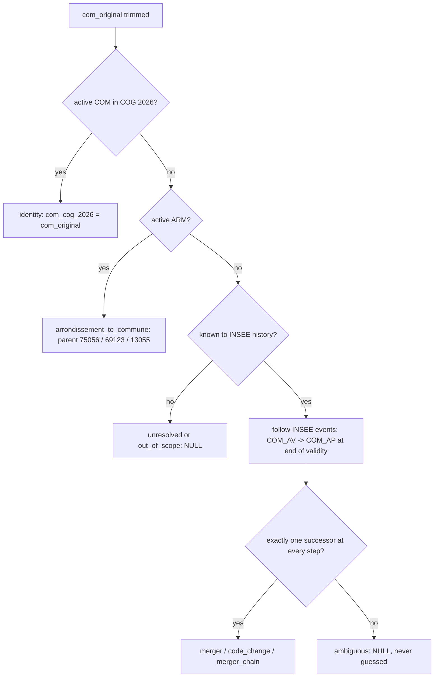

# Phase 2 — Geographic Data Model
**Road Safety Intelligence — France** · Status: **DESIGN ONLY**
Inputs: BAAC coordinates and codes, IGN ADMIN EXPRESS COG 2019–2025, INSEE COG 2026, Phase 1C validation (`reports/geography/geographic_validation_report.md`), Phase 1D mapping (`reports/geography/commune_code_mapping_report.md`).

---

## 1. Coordinate reference systems

| Data | Native CRS (verified) | Stored as | Reason |
|---|---|---|---|
| BAAC `lat`/`long` | WGS84 geographic (ONISR doc: "projection WGS84"), decimal comma | `lat`, `lon` double (4326 values) + `geom_original` **Point, EPSG:2154** | metric analysis |
| IGN 2019, 2020 editions | EPSG:4326 (France entière) | MultiPolygon **2154** | reprojected at load |
| IGN 2021–2024 editions | IGNF:LAMB93 (RGF93 Lambert-93) | MultiPolygon **2154** | equivalent definition, SRID normalised |
| IGN 2025 edition | EPSG:2154 (GeoPackage) | MultiPolygon **2154** | as is |
| App display (Plotly/Streamlit) | — | `ST_Transform(geom, 4326)` in analytics views only | web maps need lon/lat |

All distances, buffers (500 m tolerance), densities and clustering are computed in **EPSG:2154 (metres)**. Overseas territories (other UTM CRSs) are out of the core scope and their polygons are not loaded.

---

## 2. Reference geometry tables

| Table | Content | Use |
|---|---|---|
| `ref.ign_commune (edition_year, insee_com)` | metropolitan communes, 7 editions (34 886 → 34 746 polygons) | (a) validation of year *Y* accidents with edition *Y*; (b) edition **2025 = COG 2026 geometry** for maps of `com_cog_2026` |
| `ref.ign_departement (edition_year, insee_dep)` | 96 metropolitan departments per edition | department consistency check, department maps |
| *(optional, not designed in detail)* `ref.ign_arrondissement_municipal` | Paris/Lyon/Marseille arrondissements — present only in the extracted 2025 GeoPackage | arrondissement-level analysis if approved |

**Verified:** the COG 2026 metropolitan commune list and the IGN 2025 edition contain exactly the same 34 746 codes; INSEE records no COM→COM code change effective after 2025-01-01 (only 19 renamings and suppressions of delegated/associated communes). The 2025 polygons are therefore a valid geometry for COG 2026 communes. *Not verified:* whether the 2026 suppression of 40 delegated/associated communes altered any COM boundary (expected not, since COM codes are unchanged); IGN 2026 edition exists if needed (`ADMIN-EXPRESS-COG_4-0__GPKG_LAMB93_FXX_2026-01-01`).

Geometry hygiene: `ST_MakeValid` at load (4 invalid commune and 4 invalid department polygons in the 2019 edition), flag `geom_was_invalid`; GiST index on every geometry column.

---

## 3. Geographic identifiers on `clean.accident`

| Field | Meaning | Rule |
|---|---|---|
| `dep_original` | department as published | verbatim |
| `dep_code` | normalised department | zero-pad 2019 single digits (2 966 accidents); `2A`/`2B` kept |
| `is_metro` | core scope | dep_code ∈ 01–95, 2A, 2B (361 593 accidents) |
| `com_original` | commune as published | verbatim (trimmed) — **never overwritten** |
| `com_arm` | municipal arrondissement | set when com_original is an active ARM (751xx, 6938x, 132xx) |
| `com_cog_at_date` | INSEE commune valid on the accident date | INSEE chain followed until a code valid on `acc_date` |
| `com_cog_2026` | commune in the COG 2026 reference | `ref.commune_code_harmonisation` |
| `com_mapping_class` | identity / arrondissement_to_commune / merger / code_change_one_to_one / merger_chain / unresolved / out_of_scope | from harmonisation |
| `com_mapping_confidence` | exact / high / medium / none | §4.3 |

---

## 4. Commune harmonisation to COG 2026 — applied to **all** BAAC codes

### 4.1 Algorithm (deterministic, no inference)

Successor rule: rows of `ref.insee_cog_event` with `com_av = code`, `typecom_av = 'COM'`, `typecom_ap = 'COM'`, `com_ap ≠ code`, `date_eff` = end of validity of `code` as COM (tolerating the day-after convention). Class from the INSEE `MOD` of the first step: 31/32/33/34 → merger, 41/50 → one-to-one code change; multi-step → merger_chain.

### 4.2 Verified coverage (all BAAC codes 2019–2025)

| Status | Codes | Accidents | com_cog_2026 |
|---|---|---|---|
| Active COM 2026 (identity) | 25 042 | 313 631 | = original |
| Active municipal arrondissement | 45 | 46 883 | parent commune |
| Obsolete, resolved via INSEE (1 step: 301; 2 steps: 5) | 306 | 1 078 | successor |
| Unresolved (`N/C`) | 1 | 1 | NULL |
| *Overseas collectivities 975/977/978/986/987/988* | 69 | (out of scope) | NULL (`out_of_scope`) |
| **Metro total** | **25 394** | **361 593** | 361 592 harmonised |

Obsolete codes by accident year: 2019: 349 · 2020: 225 · 2021: 220 · 2022: 72 · 2023: 84 · 2024: 62 · 2025: 67 accidents. Of these, the 598 accidents of Phase 1D used codes already obsolete **on the accident date**; the other ~481 used codes valid on the date that were merged later (2020–2026) — which is why `com_cog_at_date` and `com_cog_2026` are kept separately. No ambiguous (multi-successor) case exists.

### 4.3 Confidence
| Value | Rule |
|---|---|
| exact | identity or arrondissement→parent |
| high | deterministic INSEE mapping **and** the accident point lies in the successor commune |
| medium | deterministic INSEE mapping, point in another commune (Phase 1D: 18 cases, median 58 m from successor) |
| none | unresolved / out of scope |

DQ gate: the Phase 1D figures must be reproduced exactly (598 accidents: 579 high, 18 medium, 1 none).

### 4.4 Implications
- Commune-level statistics always use **`com_cog_2026`** (one consistent vintage across 2019–2025); mergers are many-to-one, so counts by successor are exact.
- Pre-merger (delegated) communes and arrondissements are attributes (`com_original`, `com_arm`), not spatial units (no polygons in COMMUNE layer).
- Department counts use `dep_code` (complete); the 3 legacy MOD-41 codes already carry the successor's department.

---

## 5. `clean.accident_geo_validation` (1:1 with accident)

| Column | Type | Meaning |
|---|---|---|
| num_acc | bigint PK/FK | accident |
| validation_edition_year | smallint | IGN edition used (= accident year) |
| category_declared | text | Phase 1C category vs declared code (ARM→parent): `valid`, `nearby_commune`, `wrong_commune_same_dep`, `wrong_department`, `swapped`, `placeholder_invalid`, `outside_coverage`, `commune_code_unresolved`, `out_of_scope_non_metro` |
| category_harmonised | text | same rules re-evaluated against `com_cog_at_date` (resolves the 598 `commune_code_unresolved` into valid / nearby / …; `N/C` stays unresolved) |
| placeholder_reason | text | missing_or_unparsable / zero / out_of_range / both_integral |
| com_point, com_point_dep, dep_point | char(5), varchar(3) | commune / department containing the point (edition of the year) |
| dist_declared_m | numeric(10,1) | point → declared commune polygon |
| swap_dist_m, lonsign_dist_m | numeric(10,1) | distance if lat/long swapped / longitude sign flipped |
| dep_consistent | boolean | dep_point = dep_code |
| com_consistent | boolean | com_point = declared (harmonised) commune |
| is_valid, is_within_tolerance, is_wrong_department, is_swapped, is_sign_error, is_placeholder, is_outside_coverage, is_unresolved_code | boolean | explicit flags (the user-requested distinctions) |
| correction_method | text | `swap_lat_long` (4) / `flip_longitude_sign` (7) / NULL |
| lat_corrected, lon_corrected | double | proposed corrected values |
| geom_corrected | geometry(Point, 2154) | proposed corrected point |
| correction_status | text | `proposed` (default) / `approved` / `rejected` — corrections are **never** written into `lat`, `lon` or `geom_original` |
| spatial_eligibility | text | §6 |

`is_sign_error` = longitude-sign-flipped point lies inside the declared commune (0 m) while the original point is classified wrong commune/department (Phase 1C: 7 accidents, 2019). Sign errors keep their Phase 1C category and are distinguished by the flag.

DQ gate: `category_declared` counts must equal Phase 1C exactly (valid 354 708, nearby 5 647, wrong commune 606, wrong department 23, swapped 4, placeholder 2, outside 5, unresolved 598).

---

## 6. Spatial eligibility and its effect on hotspot analysis

| spatial_eligibility | Rule | Used in default hotspot set |
|---|---|---|
| `eligible_exact` | category_harmonised = valid | yes (geom_original) |
| `eligible_tolerance` | nearby_commune (≤ 500 m; median 5 m) | yes (geom_original) |
| `eligible_corrected` | swapped / sign error **and** correction_status = approved | yes (geom_corrected) — only after approval |
| `review_wrong_commune` | wrong_commune_same_dep (606; median 1.35 km) | **no** (sensitivity analysis only) — point or code is wrong, undecidable |
| `excluded_wrong_department` | 23 | no |
| `excluded_placeholder` | 2 | no |
| `excluded_outside_coverage` | 5 | no |
| `excluded_unresolved_code` | `N/C` if point not validated | no |
| `out_of_scope` | overseas | no |

Consequences for future hotspot / density work (Phase 3+):
1. `analytics.hotspot_point` contains only eligible accidents (≈ 99.7 % of metro accidents) with the geometry to use (`geom_analysis`) and its provenance (`geom_source` = original / corrected).
2. Every hotspot output reports the number and share of excluded accidents by year and department (Haute-Corse has the highest problem share, 2.3 %).
3. Sensitivity runs: (a) exact only; (b) + tolerance; (c) + corrected; (d) + `review_wrong_commune`. Hotspots that disappear between runs are flagged as unstable.
4. 2019–2020 points are less precise (nearby median 15 m in 2019 vs 2–6 m later; more wrong-commune cases): multi-year hotspot comparisons carry the `COORD_PRECISION_2019_2020` break.
5. Repeated identical coordinates (max 18 accidents on one point) can create artificial peaks: point-stacking diagnostics are part of the hotspot method.
6. Hotspots measure **concentration of recorded injury accidents**, not risk (no traffic exposure) — `NO_EXPOSURE_DENOMINATOR` is attached to every spatial output.
7. Area aggregates (commune/department) use codes, not points, so they include accidents whose points are excluded.

---

## 7. Spatial operations and indexes (PostGIS)

| Operation | Function | Index |
|---|---|---|
| point in commune / department | `ST_Within(point, polygon)` with `edition_year = year` (same predicate as Phase 1C) | GiST on `ref.ign_commune.geom`, `ref.ign_departement.geom` |
| 500 m tolerance | `ST_DWithin(point, polygon, 500)` in 2154 | GiST |
| distances | `ST_Distance` in 2154 | — |
| hotspot input | `analytics.hotspot_point.geom_analysis` (Point 2154) | GiST |
| display | `ST_Transform(geom, 4326)` | — |

Geometry types: `geometry(Point, 2154)` for accidents, `geometry(MultiPolygon, 2154)` for boundaries (`ST_Multi` at load). `geography` type is not needed (metric projected CRS covers metropolitan France including Corsica).
