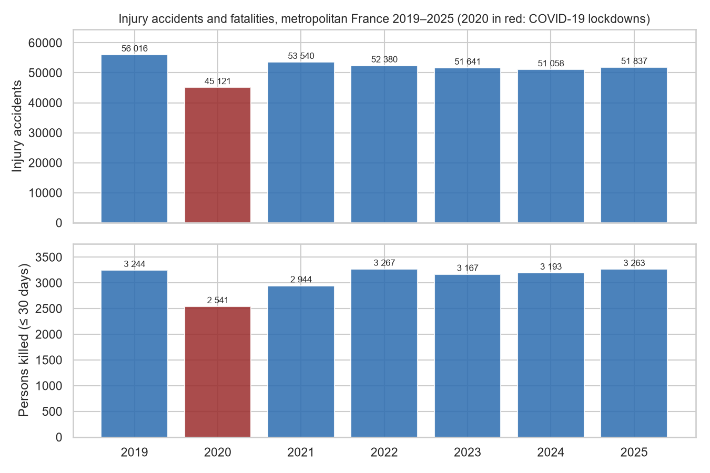
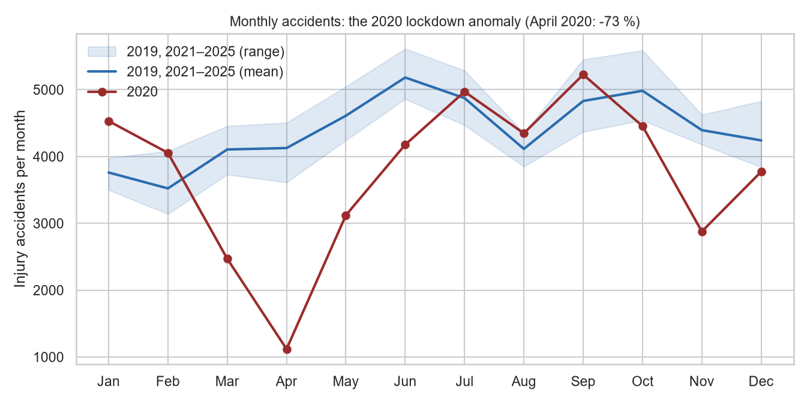
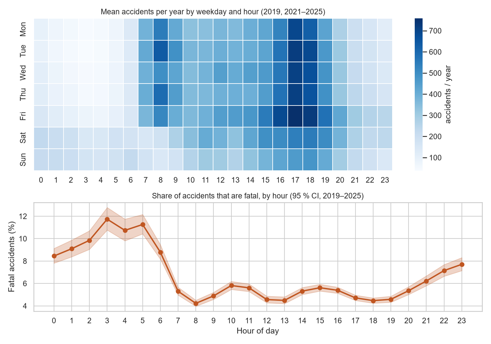
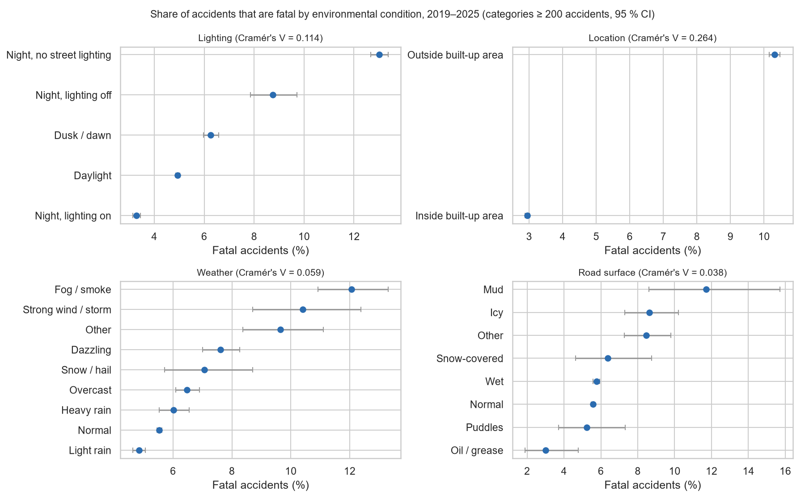
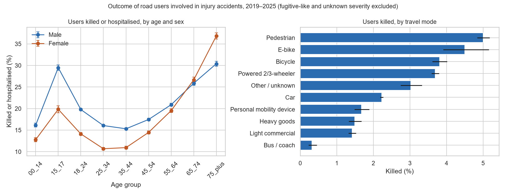

# Phase 4 — Exploratory & Statistical Analysis
**Road Safety Intelligence — France** · BAAC 2019–2025, metropolitan France · 2026-11-11

Source: `analytics.accident_fact` (361 593 accidents) and `analytics.road_user_fact` (821 517 road users), read-only.
Reproduce: `scripts/20_phase4_eda.py` → `reports/phase4/tables/*.csv`, `reports/phase4/figures/*.png`.
All findings are **descriptive associations among police-recorded injury accidents** — not risks (no traffic exposure) and not causes.

---

## 1. Accident overview

| Year | Accidents | Fatal accidents | Killed | Hospitalised* | Light | Killed / 100 accidents |
|---|---|---|---|---|---|---|
| 2019 | 56 016 | 3 050 | 3 244 | 19 609 | 50 881 | 5.79 |
| 2020 | 45 121 | 2 403 | 2 541 | 15 600 | 40 236 | 5.63 |
| 2021 | 53 540 | 2 771 | 2 944 | 17 852 | 49 205 | 5.50 |
| 2022 | 52 380 | 3 077 | 3 267 | 18 024 | 47 406 | 6.24 |
| 2023 | 51 641 | 2 984 | 3 167 | 18 051 | 46 623 | 6.13 |
| 2024 | 51 058 | 3 011 | 3 193 | 17 831 | 46 704 | 6.25 |
| 2025 | 51 837 | 3 088 | 3 263 | 18 345 | 47 021 | 6.29 |
| **Total** | **361 593** | **20 384** | **21 619** | **125 312** | **328 076** | **5.98** |

\* *hospitalised (> 24 h) is no longer a certified indicator (since 2019); comparable within 2019–2025 only.*

- **Severity distribution (most severe outcome per accident):** light 64.4 % · hospitalised 30.0 % · fatal 5.6 %.
- Recorded accidents fell from 56 016 (2019) to ~51–52 k (2022–2025) while fatalities stayed at ~3 170–3 270 per year; the fatal share rose from 5.2 % (2021) to ~5.9 % (2022–2025). The year–fatality association is statistically detectable but very small (χ² = 47.7, df = 5, Cramér's V = 0.012, 2020 excluded). Whether this reflects a change in severity or in the recording of less serious accidents cannot be determined from these data.
- **COVID-19 (2020):** versus the mean of the other six years, accidents −14.5 %, killed −20.1 %, hospitalised −14.7 %, light −16.1 %. Treated as an outlier throughout.

## 2. Temporal patterns

- **2020 anomaly:** April 2020 had **−73 %** accidents vs. the April mean of other years (first lockdown); March, May and November 2020 are also far below the normal range, while January–February 2020 were at or above it.
- **Season (other years):** lowest in February, highs in June and September–October.

- **Frequency:** weekday commuting peaks at 08:00 and especially 17:00–18:00 (Friday 17:00 is the busiest slot, ≈ 760 accidents/year); weekends have a flatter daytime profile and more night-time accidents.
- **Severity:** the share of fatal accidents is about **twice as high at night (00–05 h: 10.0 %) as during the day (06–23 h: 5.2 %)**, peaking at 03:00 (11.7 %) and lowest at 08:00 (4.2 %) — χ² = 1 186, V = 0.057. Weekend accidents are more often fatal than weekday ones (6.8 % vs 5.2 %; V = 0.030).

## 3. Environmental factors (accident level)

| Factor | Highest fatal share | Lowest fatal share | χ² (df) | Cramér's V |
|---|---|---|---|---|
| Location | outside built-up area 10.3 % | inside built-up area 3.0 % | 25 252 (2) | **0.264** |
| Road category (4 + 7 grouped) | departmental 9.0 %, national 7.5 % | communal/metropolitan 2.9 %, motorway 4.6 % | 26 934 (12) | **0.193** |
| Lighting | night without street lighting 13.0 % | night with lighting on 3.3 % (daylight 4.9 %) | 9 320 (8) | 0.114 |
| Weather | fog/smoke 12.1 %, strong wind 10.4 % | light rain 4.9 % (normal 5.5 %) | 2 524 (16) | 0.059 |
| Road surface | mud 11.7 %, icy 8.6 % (small n) | oil/grease 3.0 %; wet 5.8 % ≈ normal 5.6 % | 1 018 (16) | 0.038 |

Outcome: accident severity (light / hospitalised / fatal). Not recorded / conflicting values excluded: lighting 8, weather 26, surface 530 (458 multi-segment conflicts + 72 not recorded), road category 1.

- The **rural/urban contrast** is the strongest environmental association: accidents outside built-up areas are 3.5 times as often fatal.
- Lighting, road category and location are strongly inter-related (unlit night roads are mostly rural roads); these bivariate results are **not adjusted** for one another.
- Weather and surface show only weak associations; adverse conditions are rare and many accidents in bad weather occur on urban roads.

## 4. Road users (user level)

Population: 809 407 users (excluded: 12 107 fugitive-like users of 2021–2025 with no age/sex/severity information, 3 with unknown severity). Outcome: unhurt / light / hospitalised / killed.

| Factor | Notable groups (killed % · killed-or-hospitalised %) | χ² (df) | Cramér's V |
|---|---|---|---|
| Travel mode | pedestrians 5.0 % · 32.7 % · powered 2/3-wheelers 3.7 % · 34.4 % · bicycles 3.8 % · 27.8 % · e-bikes 4.5 % · 27.2 % · cars 2.2 % · 12.8 % · bus/coach 0.3 % · 2.1 % | 191 495 (27) | **0.281** |
| User category | pedestrians 5.0 % · 32.7 % · drivers 2.6 % · 17.0 % · passengers 2.0 % · 16.4 % | 46 440 (6) | 0.169 |
| Age group | U-shaped: 75 + 8.4 % · 33.1 % · 65–74 4.9 % · 26.2 % · 15–17 1.8 % · 26.6 % · 25–44 ≈ 2.0 % · 14 % | 29 118 (24) | 0.110 |
| Sex | male 3.0 % · 19.0 % · female 1.9 % · 16.2 % | 6 620 (3) | 0.090 |

- **Unprotected users** (pedestrians, two- and three-wheelers, cyclists) account for the most severe outcomes once involved in an injury accident.
- **Age:** older users have by far the highest fatality share; teenagers (15–17) show a marked peak in serious outcomes (likely related to two-wheeler use — not tested here).
- **Sex:** men are more often killed or seriously injured at every age below 65; from 65 the female share of serious outcomes equals or exceeds the male share (75 +: 36.8 % vs 30.4 %).
- Men make up 68 % of users involved; without exposure data this says nothing about relative risk per kilometre.

## 5. Statistical notes

Full results: `tables/08_statistical_tests.csv`.

- Pearson χ² tests of independence with Cramér's V; all expected cell counts ≥ 5 except small surface/weather categories (minimum expected 9.8).
- With N between 316 k and 809 k, **every test is significant (p < 10⁻⁸)**; significance is therefore uninformative and the effect size is reported. On the usual scale, V < 0.1 is negligible-to-weak and 0.1–0.3 weak-to-moderate: the strongest associations (travel mode 0.28, rural/urban 0.26, road category 0.19) are moderate.
- User-level tests treat users as independent, but users are clustered within accidents; p-values are overstated (V is used descriptively only).
- Bivariate associations only — confounding (e.g. night × rural roads × speed limit) is not controlled, by design (no modelling in this phase).

## 6. Validation

`tables/00_reconciliation.csv` — all derived tables reconcile with the database: accidents 361 593 (annual, monthly, weekday × hour, each environmental table, department aggregate), killed 21 619 (annual = `accident_fact` = `clean.road_user`), road users 821 517. The analysis session was read-only; no database object was modified.

## 7. Limitations

1. **Recorded injury accidents only, no exposure:** counts and shares describe concentration and severity *given* an injury accident, not risk.
2. **Hospitalised indicator not certified** (and not comparable before 2018); fatality-based measures are the most robust.
3. **2020 COVID anomaly:** excluded from the weekday × hour profile and the year trend test; shown separately.
4. **Recording changes:** fugitive users (2021+) excluded from user-level analysis; road-category codes 4 and 7 grouped (`CATR7_UNSTABLE`); multi-segment Lieux conflicts excluded (surface 458).
5. **Missing values** excluded per variable (counts given above); age missing for 881 users, sex for 20.
6. Associations are bivariate, unadjusted and non-causal.

## 8. Files created / modified

| Path | Purpose |
|---|---|
| `scripts/20_phase4_eda.py` | read-only extraction, statistics, figures, reconciliation |
| `reports/phase4/tables/00–08_*.csv` | 9 result tables |
| `reports/phase4/figures/fig1–fig5_*.png` | 5 figures |
| `reports/phase4/eda_statistical_analysis_report.md` | this report |
| `requirements.txt` | added `scipy==1.18.1`, `matplotlib==3.11.2`, `seaborn==0.13.2` |
