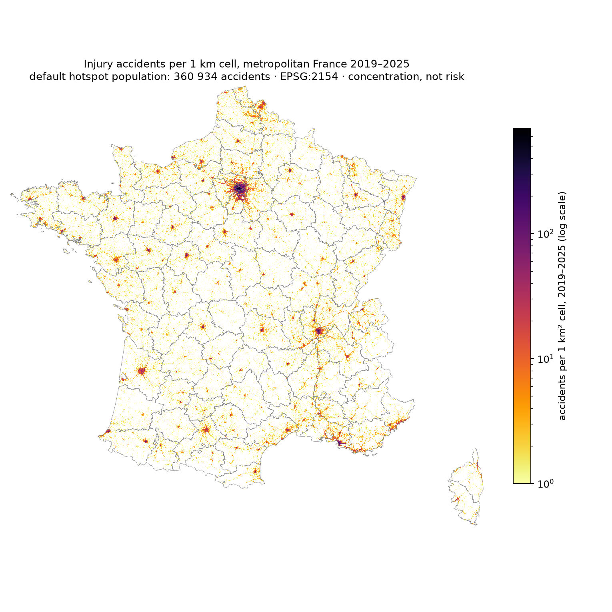
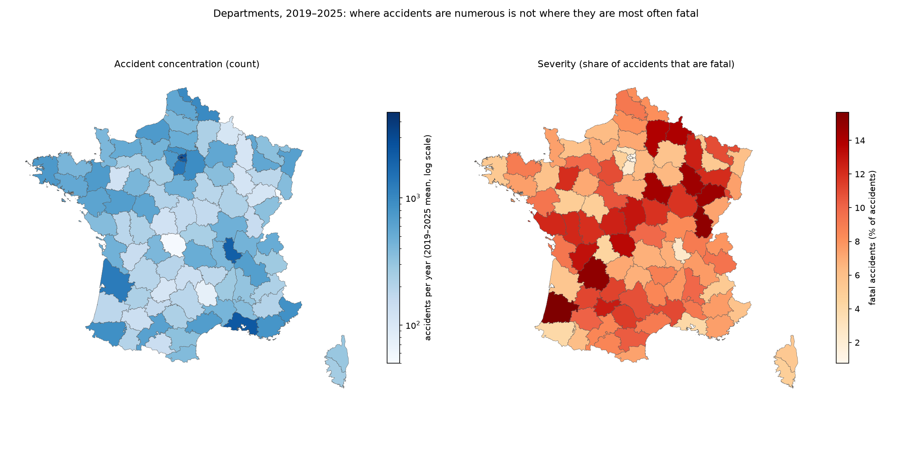
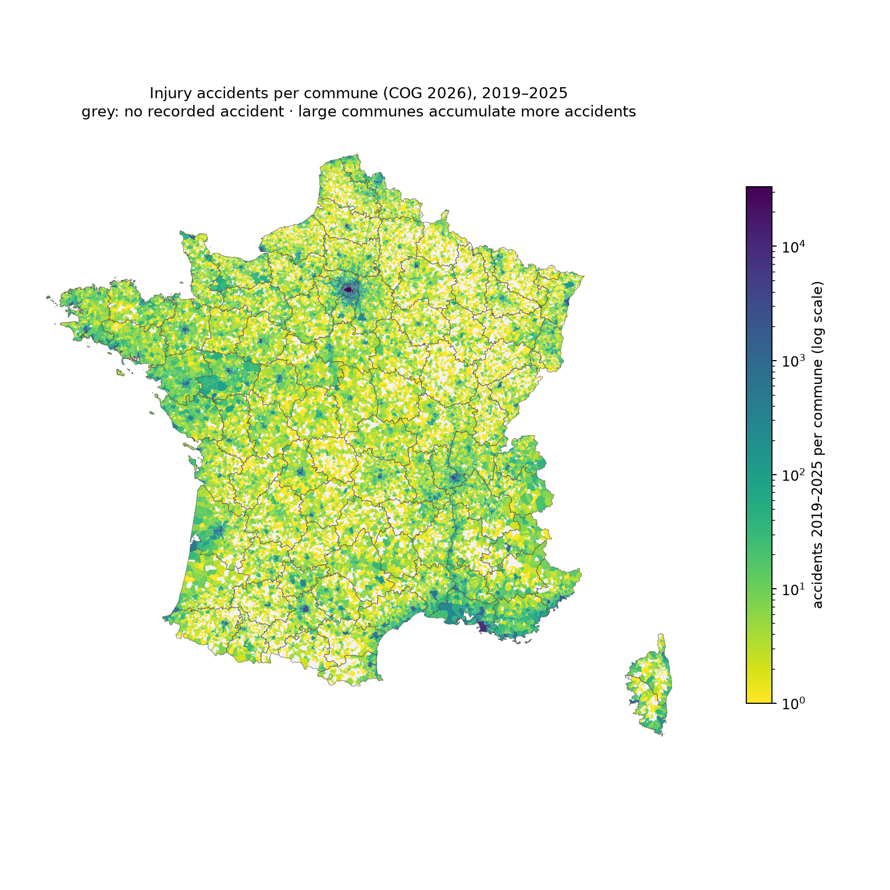
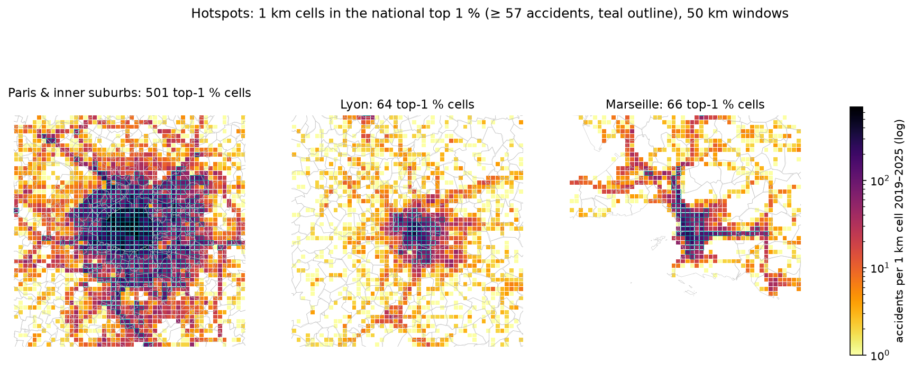

# Phase 5 — Geospatial Analysis & Accident Hotspots
**Road Safety Intelligence — France** · BAAC 2019–2025, metropolitan France · 2026-11-11

Reproduce: `scripts/21_phase5_geospatial.py` (read-only) → `reports/phase5/tables/*.csv`, `reports/phase5/figures/*.png`.
All results describe **where recorded injury accidents concentrate — not where travel is most dangerous** (no traffic-volume data).

---

## 1. Methods

| Item | Choice |
|---|---|
| Data | `analytics.accident_fact` (361 593 accidents), `analytics.hotspot_point` (default hotspot population, 360 934), `analytics.agg_year_department` / `agg_year_commune`; IGN 2025 boundaries (= COG 2026; communes `commune_type = 'COM'`) |
| Area aggregates | by **code** (all 361 593 metropolitan accidents, incl. those with excluded points); communes harmonised to COG 2026 |
| Hotspot method | **one** method: regular **1 km × 1 km grid in Lambert-93 (EPSG:2154)** computed in PostGIS on the default hotspot population; *high-concentration cell* = top 1 % of non-empty cells (2019–2025 total); *persistence* = number of normal years (2019, 2021–2025) in which the cell is in that year's top 1 % |
| Why not KDE | a fixed grid gives the same picture at 1 km, is exactly reproducible, sums back to accident counts and needs no bandwidth choice |
| Hotspot population | `valid` + `nearby_commune` + high-confidence harmonised codes; **606 wrong-commune points, 18 medium-confidence, 35 excluded points and the 11 uncorrected proposals are not used** |
| Severity | fatal share of accidents (Wilson 95 % CI) by department; fatal accident counts per 1 km cell |
| Context | legal population per commune read from the IGN 2025 file already in `data/raw` — shown next to counts, **never used as a denominator** |
| Maps | geometries simplified for display only (communes 250 m, departments 500 m); computations use full geometries / exact points |

## 2. National distribution

- Accidents follow the urban and road hierarchy: Paris and its inner ring dominate, followed by the Lyon, Marseille–Aix, Lille, Bordeaux, Toulouse, Nice and Strasbourg areas; motorway and national-road corridors (e.g. the Rhône valley) are visible as lines.
- 88 256 of the 1 km cells contain at least one eligible accident over seven years.

## 3. Departments: concentration versus severity

**Highest accident counts (2019–2025)** — the top 10 departments hold **40.7 %** of all accidents:

| Department | Accidents | per year | Killed | Fatal share |
|---|---|---|---|---|
| 75 Paris | 33 111 | 4 730 | 258 | 0.8 % |
| 93 Seine-Saint-Denis | 18 950 | 2 707 | 182 | 0.9 % |
| 92 Hauts-de-Seine | 16 656 | 2 379 | 160 | 0.9 % |
| 13 Bouches-du-Rhône | 16 519 | 2 360 | 706 | 4.1 % |
| 94 Val-de-Marne | 15 800 | 2 257 | 153 | 1.0 % |
| 69 Rhône | 14 455 | 2 065 | 395 | 2.6 % |
| 91 Essonne | 9 437 | 1 348 | 235 | 2.4 % |
| 33 Gironde | 9 012 | 1 287 | 520 | 5.5 % |
| 59 Nord | 6 844 | 978 | 594 | 8.1 % |
| 77 Seine-et-Marne | 6 507 | 930 | 441 | 6.4 % |

**Highest fatal share** (departments with ≥ 1 000 accidents): Landes 15.7 % [13.8–17.8], Jura 15.1 %, Dordogne 15.0 %, Yonne 14.4 %, Aisne 13.9 %, Charente 13.1 %, Cher 12.9 %, Tarn-et-Garonne 12.7 %, Deux-Sèvres 12.3 %, Vendée 12.3 %. **Lowest:** Paris 0.8 %, Hauts-de-Seine, Seine-Saint-Denis, Val-de-Marne (≈ 0.9–1.0 %).

→ The two maps are almost mirror images: dense urban departments record the most accidents but the fewest fatal ones; rural departments of the centre, south-west and north-east record far fewer accidents, of which 12–16 % are fatal (consistent with the rural/urban contrast of Phase 4).

## 4. Communes

| Commune (COG 2026) | Population | Accidents 2019–2025 | 2019 | 2025 | Years in national top 20 |
|---|---|---|---|---|---|
| Paris | 2 113 705 | 33 111 | 5 610 | 3 681 | 7 |
| Marseille | 877 215 | 8 711 | 1 853 | 914 | 7 |
| Lyon | 520 774 | 5 354 | 1 021 | 584 | 7 |
| Rennes | 227 830 | 2 116 | 363 | 233 | 7 |
| Saint-Denis | 148 907 | 2 090 | 317 | 280 | 7 |
| Toulouse | 511 684 | 2 009 | 403 | 262 | 7 |
| Angers | 157 555 | 1 929 | 330 | 248 | 7 |
| Reims | 178 478 | 1 923 | 272 | 326 | 7 |
| Strasbourg | 291 709 | 1 863 | 369 | 269 | 7 |
| Limoges | 129 754 | 1 726 | 264 | 228 | 7 |

Full list: `tables/02_communes.csv`.

- **Consistently high (top 20 in all 7 years):** Paris, Marseille, Lyon, Rennes, Saint-Denis, Toulouse, Angers, Reims, Strasbourg, Limoges, Bordeaux, Tours, Gennevilliers, Nanterre.
- Rankings mix very different communes (Paris: 105 km², 2.1 M inhabitants; Gennevilliers: 12 km², 51 k): **counts must not be compared as risk**; population is shown for context only. Some large cities (Nice, Montpellier) record fewer accidents than smaller ones, which may partly reflect local recording practice — not testable here.
- **Change across years:** the share of accidents in the 1 % of communes with most accidents fell from 57.3 % (2019) to 54.7 % (2022) and 50.9 % (2025) — e.g. Paris −34 %, Marseille −51 % between 2019 and 2025 — while about 11 000–11 400 communes record at least one accident each year. Department rankings are very stable (Spearman ρ 2019 vs 2025 = 0.94); commune rankings much less so (ρ = 0.38, driven by the many communes with 0–2 accidents). A few departments changed strongly (2019 → 2025: Charente-Maritime −41 %, Vaucluse +136 %); such jumps may reflect recording changes and are not interpreted.

## 5. Hotspots (1 km grid)

- **Threshold:** a cell is a high-concentration cell if it holds ≥ **57** eligible accidents over 2019–2025 (top 1 % of 88 256 non-empty cells).
- **897 hotspot cells (1 % of non-empty cells) hold 117 469 accidents = 32.5 %** of the default population; **132** of them are in the top 1 % in every normal year (persistent hotspots).
- **Where:** Paris (104 cells, 33 864 accidents), Marseille (54), Lyon (37), then inner-suburb communes (Saint-Denis, Gennevilliers, Nanterre, Boulogne-Billancourt, La Courneuve, Créteil) and regional centres (Reims, Angers, Rennes). The ten densest cells are all in central Paris (513–692 accidents per km² over seven years) and all are persistent.
- The 50 km windows show that hotspots are contiguous urban cores plus radial arterial roads (visible in Marseille and the Paris suburbs).

## 6. Severity geography

- **Fatal accidents are dispersed, not concentrated:** the hotspot cells hold 32.5 % of accidents but only **6.2 % of fatal accidents**; fatal accidents are spread over 17 827 different cells (≈ 1.1 fatal accidents per cell).
- The 1 km cells with the most fatal accidents hold only 6–9 fatal accidents in seven years (Nice, central Paris, Saint-Denis, Lyon, Marseille, Bordeaux) — mostly dense urban cells with large totals; one rural cell near Sainte-Soulle (Charente-Maritime) recorded 6 fatal accidents out of 6 accidents. At this scale fatal counts are too small for reliable cell-level ranking; the **department fatal share map (Figure 2, right)** is the appropriate severity view.
- Counts and severity proportions therefore point to different places: urban cores for accident concentration, rural networks for the share of accidents that are fatal.

## 7. Validation (`tables/00_validation.csv`) — all pass

| Check | Result |
|---|---|
| Σ department accidents = Σ commune accidents (incl. `N/C`) = `accident_fact` | 361 593 = 361 593 = 361 593 |
| Σ department killed = `accident_fact` | 21 619 = 21 619 |
| Σ grid accidents = `hotspot_point` = eligible accidents in `accident_fact` | 360 934 (×3) |
| non-eligible, wrong-commune or correction-proposal accidents in the hotspot population | 0 · 0 · 0 |
| `hotspot_point` SRID ≠ 2154 / duplicate accidents | 0 · 0 |
| departments mapped | 96 / 96 |

Spatial calculations (grid, areas) are done in EPSG:2154; no database object was modified (read-only session).

## 8. Limitations and interpretation

1. **Concentration ≠ risk** — no exposure data (traffic, kilometres driven, population present). Large or busy places accumulate more accidents.
2. **Commune comparisons** mix very different sizes and road networks; population is context only, not a rate base (resident population ≠ road users).
3. **Default population excludes 659 accidents** (0.18 %): 606 wrong-commune points (sensitivity only), 18 medium-confidence harmonised codes, 35 invalid / wrong-department / swapped / placeholder points; the 11 proposed corrections are not applied.
4. **Grid artefacts** — results depend on the 1 km cell size and origin; hotspots are cells, not road segments.
5. **2019–2020 coordinates are less precise**; 2020 (COVID) is included in totals and excluded from persistence.
6. **Recording practices may differ between police / gendarmerie areas and change over time** (e.g. large department jumps); not investigated.
7. Fatal counts per cell are small; cell-level severity is not robust.

## 9. Files created / modified

| Path | Purpose |
|---|---|
| `scripts/21_phase5_geospatial.py` | read-only extraction, 1 km grid, rankings, maps, validation |
| `reports/phase5/tables/00–05_*.csv` | validation, departments, communes, hotspot cells, hotspot cells by commune, fatal concentration cells |
| `reports/phase5/figures/fig1–fig4_*.png` | national 1 km map, departments (count vs severity), communes, hotspot zooms |
| `reports/phase5/geospatial_analysis_report.md` | this report |
